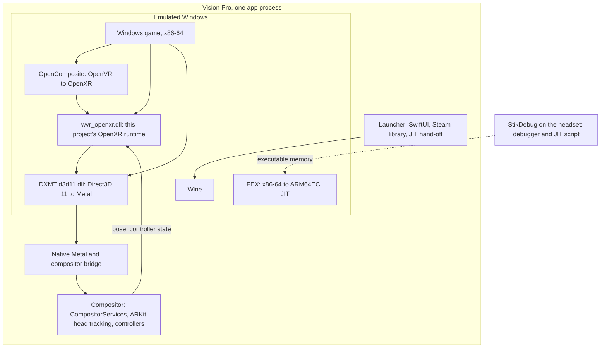

# WineVision VR

WineVision VR runs Windows PC VR games on an Apple Vision Pro, with no PC and no streaming. The game's x86-64
code is translated to ARM on the headset (Wine and FEX), its Direct3D 11 graphics are translated to Metal (DXMT),
and its OpenXR or OpenVR output is shown as an immersive space. Games come from your own Steam account, through a
Steam client that runs inside the app. No game content is distributed with this project.

It started as a fork of [AVP Play](https://github.com/myMartek/avp-play) and has since become a separate project;
see [Inspiration and credits](#inspiration-and-credits).

> **Research software.** It has been built and tested by one person on one headset. Expect rough edges.

## Donations

This project is a passion project and I will continue it regardless but any contribution is welcome:
https://ko-fi.com/hudsonmcox


## Status

As of 2026-10-14, on one headset (M2 Vision Pro, visionOS 27.2):

- Works: Steam sign-in, downloads and launch inside the app; Moss: Book II starts, renders in the headset,
  tracks your head, takes controller input (triggers, sticks, buttons) and plays audio, and gets past the
  book's page-flip that used to freeze it.
- Not working: BONEWORKS does not start (a fault while OpenComposite's DLL initialises).
- Slow: about 24 to 29 new game frames per second at 1888×1792 per eye. The display shows about 90 Hz because the
  compositor reprojects the last real frame to your current head pose. This is not 90 FPS gameplay.
- Needs JIT through the separate StikDebug app on every launch, and one session per app launch (quit and
  reopen to start another game).
- Everything else, other games, other headsets, M5 and sustained play, is untested. Treat it as a research
  build, not a release.

## How it works



| Part | Role | Where |
|---|---|---|
| Launcher | Game library, Steam sign-in, downloads, launch profiles, status; owns the immersive space | `visionos-windows-vr/Sources/` |
| Runtime plugin | Wraps Madeira's Wine and FEX behind a small C API (`windows_vr_launch_v1`) | `windows-runtime-plugin/` |
| Madeira, Wine, FEX | Wine inside an iOS or visionOS process; FEX translates x86-64 | `third-party/madeira` (fetched) |
| DXMT | Direct3D 11 to Metal, plus this project's VR frame-transfer extension | `windows-vr-openxr/patches/` on the pinned DXMT |
| OpenXR runtime | `wvr_openxr.dll`: poses, input, haptics and swapchains for the game | `windows-vr-openxr/src/WindowsVROpenXR.cpp` |
| OpenComposite | OpenVR games (Unity) go through it to the OpenXR runtime | `windows-vr-openvr/` |
| Compositor bridge | Bounded frame queue, ordered completion tickets, tracking and controller state | `windows-vr-native/` |
| Compositor | Takes the newest game frame, writes colour and depth into the headset's eye textures, reprojects, presents | `visionos-windows-vr/Sources/Rendering/` |

When you press Launch: the launcher asks StikDebug to attach its debugger, opens the immersive space, registers
the OpenXR (and OpenVR) runtime in the Wine prefix, and hands the request to the plugin. Wine starts the Steam
helper, which starts Steam, which starts the game. The game renders both eyes into one 3776×1792 image; the
compositor crops the two 1888×1792 halves into the headset's eye textures.

## Notable fixes and design decisions

Headset-confirmed unless marked otherwise. The full engineering record is in `docs/`.

- **Startup:** Steam helper files were overwriting Wine's `ntdll.dll` on incremental builds, so Wine quit before
  the game started and the launcher waited forever. Files are now copied individually and a post-build check
  (`windows-vr-tools/verify_wine_bundle.sh`) fails the build if the loader files are missing. (Rebuilt; a clean
  headset launch is the confirmation still to do.)
- **Memory:** the app must be signed with `com.apple.developer.kernel.increased-memory-limit`, otherwise the
  runtime is capped near 5 GB and heavy scenes die. The log line to look for is `clamping reported physical
  memory ... -> 8192 MB`.
- **Picture:** the OpenXR runtime now accepts the mutable-format swapchain flag Unreal sets, puts LOCAL space at
  eye level (it was on the floor) and offers STAGE; the compositor accepts DXMT's frame-ready event, writes
  opaque colour with real depth in one pass (zero depth made the picture invisible), uses a full immersive
  space, hides upper limbs and system overlays, and reprojects cached frames.
- **Input:** Touch-profile bindings (X/Y, thumbstick axes, trigger and squeeze as analog and click, shared
  sources, initial profile event) and controller discovery for visionOS 27 spatial accessories.
- **Freezes:** DXMT's VR image-wait and frame-submit commands now close the active pass and take the context
  lock (patch 0013); visibility queries that end in an empty command chunk now complete (patch 0011); query
  publication (patch 0010), with exact GPU event completion preserved; FEX address-translation caches (patch
  `windows-runtime-plugin/patches/0003`).
- **Startup repair (headset validation pending):** only the built-in display publishes stereo readiness;
  capture reuses its snapshot. Cooperative audio preserves the JIT helper. See the
  [routing and freeze investigation](docs/windows-vr-drawable-routing.md).
- **CPU optimization (headset validation pending):** patch 0015 removes repeated completed-query allocations
  and per-sample atomic additions. Host lifecycle/race checks and the ARM64EC build pass; no game FPS gain
  has been measured. The unsafe whole-buffer completion cache (retired patch 0014) is removed.
- **Shaders:** AIR container, SDK metadata and discard-CFG fixes (patches 0007 to 0009).
- **Race fix:** a lock around OpenXR action state, which had crashed the game.
- **Steam:** a native Steam library (password, Steam Guard or QR sign-in, depot downloads, Keychain tokens),
  "Prepare Valve client", and Madeira Dock. See [docs/windows-vr-steam.md](docs/windows-vr-steam.md).
- **Boneworks:** OpenVR path registration next to the OpenXR one, static C++ linking of the x64 VR DLLs and
  startup tracing. Not yet fixed.
- **Diagnostics:** `launcher-log.txt` (milestones, compositor statistics, bridge and thread traces, PNG probes
  of what the compositor received and drew), a 60 s startup-stall watchdog with all-thread dumps, and an OpenXR
  call trace. They are on while `WVRDiagnostics` is true in the app's Info.plist and should be turned off for a
  release.
- **Not reproducible from source:** the prebuilt runtime plugin carries two binary patches (a 640 MB JIT pool and
  a Mach-port registration stub). They have to be ported into source patches before a clean rebuild.

The full engineering record is in `docs/windows-vr-*.md` (status, graphics, input, freeze, performance, packaging,
Steam, simulator). The patch files are numbered in `windows-vr-openxr/patches/` and
`windows-runtime-plugin/patches/`.

## Set it up for yourself

These are the steps that worked on the author's Mac. Step 4 is long and was completed only once; expect to debug
it.

**What you need**

| | |
|---|---|
| Mac | Apple silicon, macOS 14 or later, about 60 GB free for the build, full Xcode 27 with the visionOS 27 SDK, and Apple's Metal Toolchain (`xcodebuild -downloadComponent MetalToolchain`) |
| Tools | `brew install xcodegen cmake ninja meson bison python3 git` (CMake 3.28 or newer, bison 3 or newer) |
| Headset | Vision Pro on visionOS 27, Developer Mode on, paired with Xcode, same Wi-Fi as the Mac |
| Apple account | A development team in Xcode. The author's team profile included the increased-memory-limit entitlement; if yours cannot provision it, remove it from `Resources/VisionOSWindowsVR.entitlements` and expect the 5 GB cap |
| JIT | [StikDebug](https://github.com/StikDebug/StikDebug) installed and paired on the headset |
| Compiler | [llvm-mingw 20260421, ucrt, macOS universal](https://github.com/mstorsjo/llvm-mingw/releases/tag/20260421) (SHA-256 `bd85a3975723815cef28dbbd2ca2cb0c926f6b348a12a0453f39f7af273cb3f7`), extracted anywhere |
| Steam | An account that owns a Windows VR game that works with D3D11 |

1. **Clone the branch and read the notices.**
   ```bash
   git clone https://github.com/HudsonMCox/WineVisionVR.git && cd WineVisionVR
   ```
2. **Create a clean Wine prefix template once.** Upstream provides none. Build the pinned Wine host from the
   Madeira source, set `AVPPLAY_PREFIX_WINE_BIN` and `AVPPLAY_PREFIX_WINEBOOT_BIN` to its executables, then run
   `windows-vr-tools/create_prefix_snapshot.sh`. It writes a template archive and a provenance JSON.
   Details: [windows-vr-tools/README.md](windows-vr-tools/README.md).
3. **Set the build inputs.**
   ```bash
   export DEVELOPER_DIR=/Applications/Xcode.app/Contents/Developer
   export AVPPLAY_ALLOW_RUNTIME_BUILD=1
   export AVPPLAY_BUILD_WINE_PE=1
   export AVPPLAY_RUNTIME_SOURCE="$HOME/avpplay/runtime-source"        # fresh, absolute
   export AVPPLAY_BUILD_ROOT="$HOME/avpplay/build"                      # outside the checkout
   export AVPPLAY_LLVM_MINGW_ROOT="/absolute/path/to/llvm-mingw-20260421-ucrt-macos-universal"
   export AVPPLAY_WINE_PREFIX_TEMPLATE="/absolute/path/to/clean-prefix-template.tar.gz"
   export AVPPLAY_WINE_PREFIX_PROVENANCE="/absolute/path/to/prefix-template-provenance.json"
   export AVPPLAY_DEVELOPMENT_TEAM="YOUR_TEAM_ID"     # or: export AVPPLAY_SIGN_APP=0 to build unsigned
   ```
4. **Assemble.** This fetches the pinned sources (`windows-vr-tools/sources.lock.json`) into `third-party/`,
   prepares the overlay, builds the native Wine, FEX and DXMT libraries for visionOS, the ARM64EC guest DLLs, the
   x64 OpenXR and OpenComposite DLLs, stages and validates everything under
   `visionos-windows-vr/Resources/`, and builds the app.
   ```bash
   bash windows-vr-tools/assemble_runtime.sh
   ```
5. **Check the bundle before installing.** Both of these must pass; a missing `ntdll.dll` or entitlement is the
   most common reason a launch never starts or dies early.
   ```bash
   APP="<DerivedData or build output>/Debug-xros/WineVision VR.app"
   bash windows-vr-tools/verify_wine_bundle.sh "$APP"
   codesign -d --entitlements :- "$APP" 2>/dev/null | grep increased-memory-limit
   ```
6. **Install on the headset.**
   ```bash
   xcrun devicectl list devices
   xcrun devicectl device install app --device <UDID> "$APP"
   ```
   If you only change app code afterwards, rebuild with the generated project and do not pass
   `CODE_SIGN_ENTITLEMENTS=` on the command line (an empty value strips the memory entitlement). With a runtime
   framework already built into `dist/`, `visionos-windows-vr/project.prebuilt.yml` rebuilds just the app:
   `xcodegen generate --spec project.prebuilt.yml`, then
   `xcodebuild -project VisionOSWindowsVRPrebuilt.xcodeproj -scheme VisionOSWindowsVR -configuration Debug -destination id=<UDID> -allowProvisioningUpdates DEVELOPMENT_TEAM=<TEAM> build`.
7. **On the headset, once:** open WineVision VR, allow world sensing and accessory tracking when asked. Open the
   Steam library, sign in, choose **Prepare Valve client**, then download your game. Choose the game's Play
   menu and a Windows or VR launch option.
8. **Every launch:** press **Launch game**. The app hands off to StikDebug, which attaches its debugger; wait for
   the immersive space, and give the first start a few minutes (the game's code is translated as it runs, and
   memory climbs to several GB). You should hear audio first and see the game's first screen shortly after. To
   run another game or relaunch, quit and reopen the app.

**If it does not start or look right**

- The launcher says it "stalled while starting" after 60 s: check step 5, then rebuild.
- Black immersive space and no picture: look for `Guest frames: submitted=` and a `frame probe` in
  `launcher-log.txt`; `submit-v2-reject` lines name the compositor's reason.
- The app disappears mid-game: `xcrun devicectl device info files --device <UDID> --domain-type systemCrashLogs`
  and look for `JetsamEvent` files; check the `clamping reported physical memory` line in `madeira-log.txt`.
- Pull logs with
  `xcrun devicectl device copy from --device <UDID> --domain-type appDataContainer --domain-identifier org.avpplay.visionos-windows-vr --source Documents/launcher-log.txt --destination .`
  (also `Documents/madeira-log.txt`).

Rebuilding two parts is quick if you only change them: the OpenXR runtime
(`cmake --build` of `windows-vr-openxr`, copy `wvr_openxr.dll` to `Resources/WindowsVR/Guest/x64/`) and DXMT's
guest `d3d11.dll` (Wine's PE prerequisites out of tree, then Meson with the ARM64EC cross file, `winebuild
--builtin`, copy to `Resources/Runtime/arm64ec-windows/`, update the receipts).

## Legacy names

The project was renamed after the code was written, and a few internal identifiers still carry the old AVP Play name
because changing them would orphan data on a headset that already has the app (its downloaded games and Steam
sign-in live under the bundle identifier) or invalidate build receipts: the bundle identifier
`org.avpplay.visionos-windows-vr`, the `AVPPLAY_*` build environment variables, the `AVPPlaySteam` folder in the Wine
prefix and a few log prefixes. They are safe to rename together in a later change.

## Documentation

Everything below is in [`docs/`](docs): [status](docs/windows-vr-status.md), [plan](docs/windows-vr-plan.md),
[integration](docs/windows-vr-integration.md), [local build](docs/windows-vr-local-build.md),
[Steam](docs/windows-vr-steam.md), [D3D12](docs/windows-vr-d3d12.md), [graphics](docs/windows-vr-graphics-diagnosis.md),
[input](docs/windows-vr-input-quality-diagnosis.md), [freezes](docs/windows-vr-second-page-freeze.md),
[performance](docs/windows-vr-performance-target.md), [startup packaging](docs/windows-vr-startup-packaging.md) and the
[simulator notes](docs/windows-vr-simulator.md). Build tooling is described in
[windows-vr-tools/README.md](windows-vr-tools/README.md).

## Inspiration and credits

**What this project uses.** Madeira (Will Faust and contributors) is the foundation: Wine and FEX running
inside an iOS or visionOS process, the JIT bridge and Madeira Dock. It builds on Wine, FEX-Emu, DXMT (Feifan He, with
the Direct3D 9 frontend by David Acevedo), OpenComposite (Znixian and contributors) and Valve's OpenVR headers,
the Khronos OpenXR SDK, and LLVM with llvm-mingw (Martin Storsjo). JIT comes from the visionOS port of
[StikDebug](https://github.com/rebelancap/StikDebug-visionos) by rebelancap, StikJIT and idevice (Jackson Coxson).
[ALVR's visionOS client](https://github.com/alvr-org/alvr-visionos) was the reference for the compositor scene
policies and rotational reprojection. The Steam client code is adapted from Madeira's, by Jfishin and 125hz.
Neural foveated reconstruction and stereo frame extrapolation (Mode 4) adapts concepts, 2D Gaussian canvas reconstruction, and temporal extrapolation architecture from [OpenSuperSampling (OSS)](https://github.com/cashcon57/open-supersampling) by cashcon57 and contributors (Apache-2.0), along with stereo temporal frame generation principles (StereoFG) for cross-eye disparity feature gating.
[VeRantyx](https://github.com/Ag3497120/VeRantyx) by Ag3497120 (MIT): Reference for custom DirectX/Vulkan runtime bridge architectures on Apple Silicon, in-process synchronization models, and zero-copy IOSurface frame transport.

**Inspiration (no AVP Play code is shipped here).** [AVP Play](https://github.com/myMartek/avp-play) by myMartek, where
this started: it showed that this kind of game can be run on a Vision Pro, and a few conventions carried over (the
bilingual `L("English", "Deutsch")` helper pattern, the MIT license and the project layout). AVP Play in turn builds on
[Klepton](https://github.com/shinyquagsire23/Klepton) by Max Thomas and on [Glovebox](https://github.com/glovebox-vr/glovebox);
[xrizer](https://github.com/Supreeeme/xrizer) was considered for OpenVR and OpenComposite was chosen instead.

Licenses, exact roles and how each piece is used are in [THIRD-PARTY.md](THIRD-PARTY.md). Moss: Book II and BONEWORKS,
used for testing, belong to their publishers and are not distributed.

## License

[MIT](LICENSE) for this project's own code and documents, with the scope and exceptions described in that file:
the Steam client code is GPL-3.0-or-later with the Madeira Converter Exception, and the patches follow the license of
the project each one patches. Anyone distributing a built app has to meet the GPL and LGPL obligations of the parts
it contains. This project is not affiliated with or endorsed by Apple, Valve or any game publisher; Apple Vision Pro
and the game names are trademarks of their owners. You use it at your own risk and are responsible for playing only
games you own.

## How this project was made

Parts of the code, diagnostics and documentation were written with the help of AI coding assistants, under the
direction of the project's author and checked against a real headset where the text above says so. Please review that
work accordingly. Some of the upstream projects it builds on ask that AI-generated changes are not sent to them; see
the note on contribution policies in [THIRD-PARTY.md](THIRD-PARTY.md).
